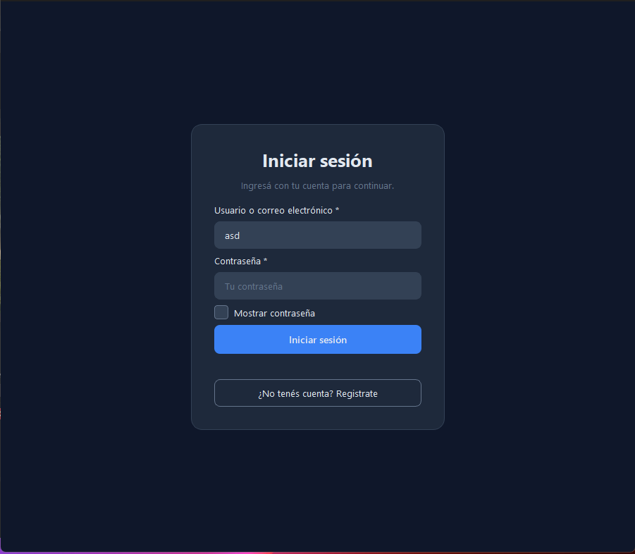
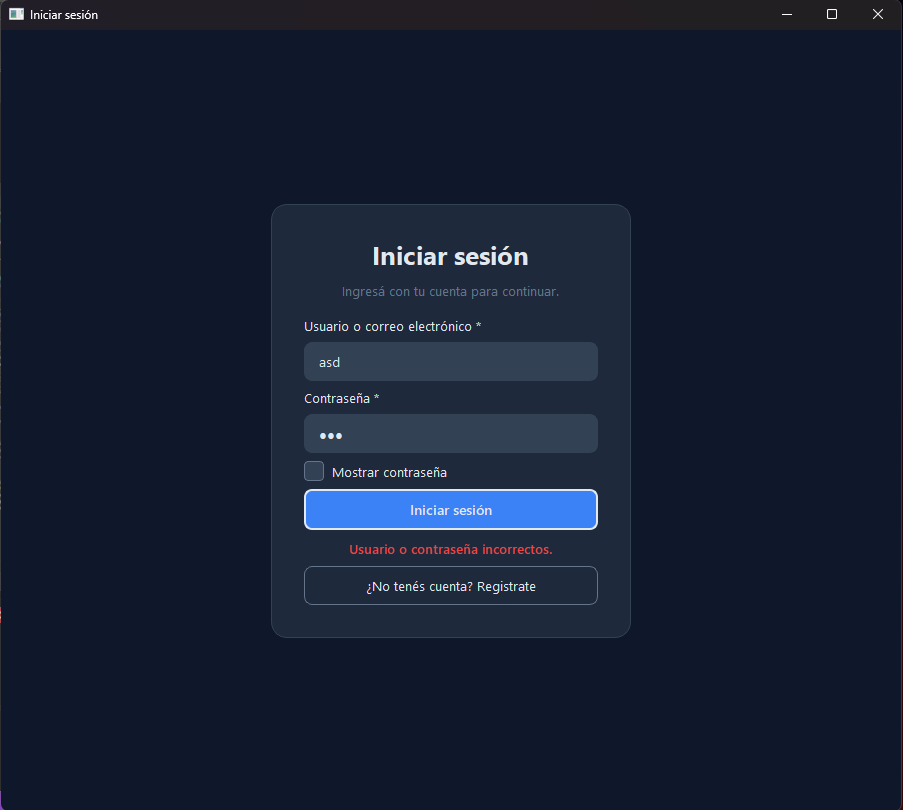
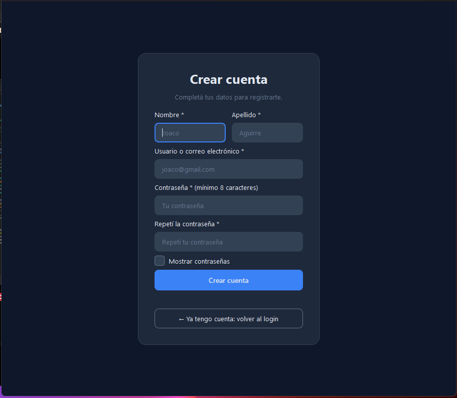
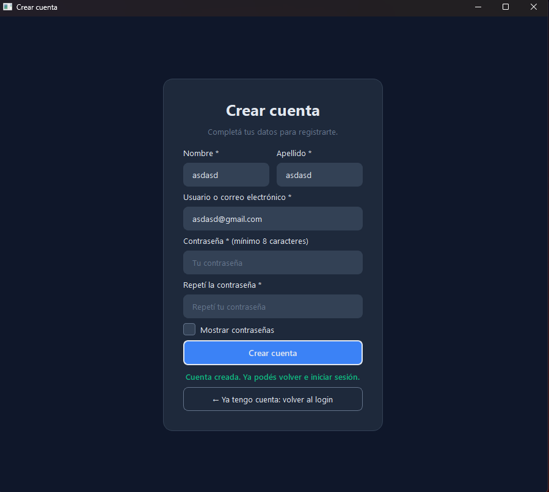
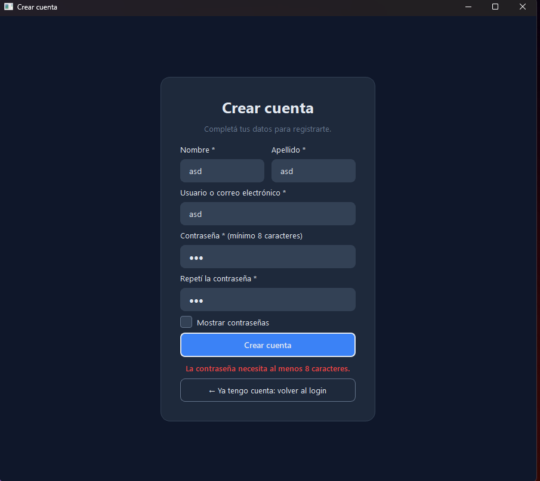

# Login y registro con PyQt6

Aplicación de escritorio con dos pantallas diseñadas en Qt Designer y controladas
con clases de Python. Trabajo práctico de Programación Orientada a Objetos.

> **Importante:** la autenticación es una SIMULACIÓN. Los usuarios viven en
> memoria y se pierden al cerrar la aplicación. No es un sistema seguro ni
> apto para datos reales.

## Capturas

## Requisitos
- Python 3.10 o más nuevo

## Instalación
Windows (PowerShell):

    py -m venv .venv
    .venv\Scripts\Activate.ps1
    python -m pip install -r requirements.txt

macOS:

    python3 -m venv .venv
    source .venv/bin/activate
    python -m pip install -r requirements.txt

Para **editar** los diseños (opcional, no hace falta para ejecutar):

    python -m pip install PySide6-Essentials
    pyside6-designer

## Ejecución
Siempre desde la carpeta del proyecto:

    python main.py

## Funcionalidades
- [x] Login y registro diseñados en Qt Designer
- [x] Cinco controles conectados (clic, Enter, mostrar contraseña, ir/volver)
- [x] Navegación entre pantallas en una sola ventana
- [x] Validación de formularios con mensajes claros
- [x] Servicio de autenticación simulado
- [x] Paleta de colores generada con ia (no soy para nada bueno eligiendolos)

## Paleta de colores
| Uso | Color |
|---|---|
| Fondo principal | `#0F172A` |
| Superficie / tarjetas | `#1E293B` |
| Bordes / campos | `#334155` |
| Texto secundario | `#64748B` |
| Texto principal | `#E2E8F0` |
| Botón primario (normal / hover / pressed) | `#3B82F6` / `#2563EB` / `#1D4ED8` |
| Éxito | `#10B981` |
| Error | `#EF4444` |
| Advertencia | `#F59E0B` |

Esta ubicada en `ventanas/estilos.qss`

## Decisiones de diseño
1. **Colores y tipografía:** genere los fonts y la paleta de colores con ia
2. **Estados de botones:** `:hover`, `:pressed`, `:disabled` y foco con teclado.
3. **Mensajes:** error, éxito y advertencia con distintos colores, y siempre con texto que diga cual error salto
4. **Casilla «mostrar contraseña»:**, use un svg que encontre

## Estructura
    main.py                      Arranca la app
    ventanas/                    login.ui, registro.ui, estilos.qss, clases de cada pantalla
    ventanas/recursos/           Un archivo svg del checkbox
    controladores/               Servicio de Autenticacion
    capturas/                    las imágenes que pedian

## Desafíos realizados
Ninguno del nivel 3

## Limitaciones conocidas
- Los usuarios se pierden al cerrar la app (no hice base de datos).
- No hay límite de intentos ni sesiones

## Autor
- Joaquin Aguirre
